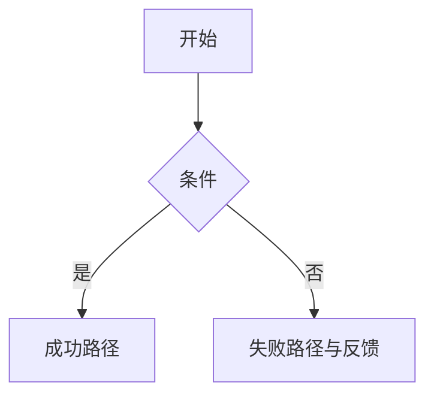

# UI/UX 规格（ui-spec）

> 产出者：UI/UX 设计师。归档：`docs/ui-spec.md`。
> 质量门禁：五态齐全（默认/悬停或聚焦/激活/禁用/加载）；空/载/错/禁四类全局态有约定；
> 站点类型已判定并应用对应模式；类型反模式清单已自查。

## 0. 站点类型（先判定，再做设计）

- **类型判定**：<企业官网 / 产品官网 / 开源项目官网 / 电商商城 / 后台管理 / 混合（分端列出）/ 未命中（列参照与待确认）>
- **判定理由**：<一句话，依据需求规格的用户与转化目标>
- **所用模式文件**：`references/ui-patterns/<file>.md`（未命中类型：标注"参照，非套用"）
- **类型专属规格**：见 §8（按模式文件展开；混合站点分端填写）。

## 1. 页面清单与层级

| 页面 | 路由 | 入口 | 出口 | 优先级 |
|---|---|---|---|---|

## 2. 信息架构（逐页）

### <页面名>

- **区块划分**：首屏必见 <…> / 滚动可见 <…> / 折叠 <…>
- **数据来源**：依赖端点（对应 api-contract）。
- **全局态呈现**：空数据 / 加载中 / 错误 / 无权限 各自如何呈现。

## 3. 核心交互流（Mermaid）

> 只画页面交互视角（单任务跨页反馈）；端到端业务全景流程见 `docs/business-process.md`
> （互链不重复）。

## 4. 组件复用清单

| 组件 | 五态 | 使用页面 |
|---|---|---|
| Button | 默认/悬停/激活/禁用/加载 | 全局 |

## 5. 视觉规范

- **色板**：主色 <hex>、辅色 <hex>、语义色（成功/警告/危险/信息）；文本对比度 ≥ 4.5:1。
- **字号阶梯**：12/14/16/20/24/32。
- **间距体系**：4/8 网格（8 的倍数）。
- **圆角与阴影**：<约定>。

## 6. 响应式断点

| 断点 | 范围 | 布局策略 |
|---|---|---|
| 移动 | <768px | 单列 |
| 平板 | 768-1024px | 双列 |
| 桌面 | >1024px | 固定侧栏 |

## 7. 表单规范（逐字段）

| 字段 | 类型 | 校验 | 错误文案（人话） | 默认值 |
|---|---|---|---|---|

## 8. 类型专属规格（按 §0 模式文件展开）

> 通用章节（1-7）全类型必填；本节按站点类型选择性展开，
> 模式文件（`references/ui-patterns/<type>.md`）中对应小节为填写引导。

- **首屏公式落地**：<主 CTA / 辅 CTA / 信任背书如何布>
- **类型核心页 IA**：<企业官网=案例中心；产品官网=定价页；电商=商详页；后台=列表页；开源=快速开始>
- **类型核心交互流**：<留资流 / 注册转化流 / 安装上手流 / 下单漏斗 / 查-改流——失败分支逐条对照模式文件清单>
- **类型专属组件**：<模式文件 §6 所列组件的落地清单（并入 §4 复用清单）>
- **信任与合规要点落地**：<按模式文件 §8 逐条落地情况>
- **反模式自查**：<模式文件反模式清单逐条自查结论；不通过的列 blocked_on>
